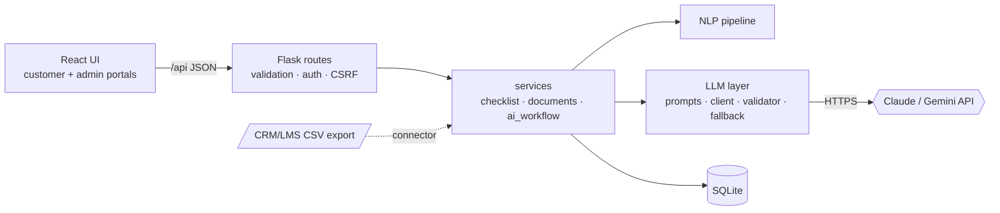

# Customer Onboarding Checklist Assistant

This app creates customer onboarding checklists from the programme a learner selects and the
documents that programme requires. It reads what learners send with NLP, uses an LLM (Claude or
Gemini) to explain what is still outstanding and to draft reminders, and keeps a human officer in
control of every message.

| | |
|---|---|
| **Repository** | https://github.com/yeshna04/onboardly |
| **Live demo** | https://customer-onboarding-dplp.onrender.com/login |
| **Stack** | Python 3.11 · Flask · sqlite3 · pandas · Anthropic SDK / Gemini REST · React 18 + Vite + TypeScript + Tailwind |

## What it does

```
Read enrolment → compare checklist → NLP document metadata extraction → LLM reminder draft → save status
```

- **Customer portal:**
  - sign up and pick a programme; a checklist is created instantly with a due date;
  - upload documents, which NLP matches to the right checklist item;
  - see what's verified, rejected (with the reason) or still needed;
  - message the onboarding team.
- **Admin portal:**
  - dashboard;
  - enrolments, plus a new-enrolment wizard;
  - verification queue;
  - CRM CSV import;
  - programme and required-document editor;
  - **AI assist** ("Explain outstanding", "Draft reminder");
  - **Reviews**: edit, publish or reject AI drafts;
  - per-enrolment **Trace**: NLP → prompt → API → validation → DB rows, plus that enrolment's audit entries.
  - Every consequential action is also written to an append-only `audit_log` table.
- **Human in the loop:** the assistant only creates *drafts*. Nothing reaches a learner until an officer
  publishes it. It never issues certificates, approves refunds, grades learners or sends messages on
  its own.

## How the brief's requirements are met

| Requirement | Where |
|---|---|
| Modular Python, input validation, exception handling | `backend/app/` (routes, services, repo); `validation.py`; typed errors in `errors.py` → consistent JSON errors |
| JSON / file / pandas processing | `connectors/crm_import.py` (pandas CSV/JSON import with a row-level error report); `services/analytics.py`; JSON sample data |
| NLP | `app/nlp/`: cleaning, tokenising, stemming, PII masking, **TF-IDF cosine similarity** and phrase/fuzzy matching, entity extraction (dates, test scores, amounts, file names), submission cues (submitted vs. "will send"), intent classification, service detection, upload classification |
| Prompt engineering | [`backend/prompts/`](backend/prompts/README.md): versioned system and task prompts, delimited context, prompt-injection guard, examples, JSON schemas, version notes |
| Real LLM API | `app/llm/client.py` (official **Anthropic SDK**, structured JSON output) and `app/llm/gemini_client.py` (Gemini REST), with timeouts, retries and typed error handling. Provider, model, tokens, latency and request id are stored for every call |
| LLM output validated and grounded | `app/llm/validator.py`: unknown documents, invented dates, links, promises and placeholders are rejected → one repair attempt → deterministic template fallback, labelled "not AI" |
| SQLite with sqlite3 | [`backend/db/schema.sql`](backend/db/schema.sql): 14 tables with PK/FK, CHECK constraints, timestamps, status fields and an append-only `audit_log` (triggers) |
| LMS/CRM workflow, synthetic data | `backend/data/sample/` (all fictional, `.test` emails); the connector boundary is documented in [ARCHITECTURE](docs/ARCHITECTURE.md) |
| At least 10 tests including edge cases | **29 tests**, see [docs/TEST_EVIDENCE.md](docs/TEST_EVIDENCE.md) |

## Documentation

| Doc | Contents |
|---|---|
| [docs/ARCHITECTURE.md](docs/ARCHITECTURE.md) | Component diagram, AI workflow sequence diagram, ER diagram, module map |
| [backend/prompts/README.md](backend/prompts/README.md) | Prompt pack: prompts, context boundaries, output JSON, validation rules, v1 → v2 notes |
| [docs/SAMPLE_RUN.md](docs/SAMPLE_RUN.md) | One complete real scenario: intake email → NLP → checklist → Gemini request and response → validation → DB rows |
| [docs/TEST_EVIDENCE.md](docs/TEST_EVIDENCE.md) | 29 test cases with inputs, expected and actual results, plus the raw run log |
| [docs/DEMO_SCRIPT.md](docs/DEMO_SCRIPT.md) | Walkthrough script: a normal scenario and a failure/recovery scenario |
| [docs/DEPLOY.md](docs/DEPLOY.md) | Deploying to Render (free tier) |

## Architecture at a glance



More detail is in [docs/ARCHITECTURE.md](docs/ARCHITECTURE.md).

## Setup and running locally

**You need:** Python 3.10 or newer (3.11 tested) and Node 18 or newer (only to build the UI).

### 1. Backend

```bash
cd backend
python3 -m venv .venv
.venv/bin/pip install -r requirements.txt
cp .env.example .env          # then edit .env (see "Configuration")
.venv/bin/python seed.py      # creates db/onboarding.db with synthetic data and prints the logins
```

### 2. Frontend (build once, then Flask serves it)

```bash
cd frontend
npm ci
npm run build
```

### 3. Run

```bash
cd backend
.venv/bin/python run.py
```

Open http://localhost:5050.

For UI development with hot reload, also run `npm run dev` in `frontend/` and open
http://localhost:5173. Vite forwards `/api` to Flask.

### Logins

| Role | How |
|---|---|
| Onboarding officer (admin) | Printed by `seed.py`. Set `ADMIN_EMAIL` / `ADMIN_PASSWORD` in `.env` before seeding to choose them, or create another with `.venv/bin/python create_admin.py --email you@example.test --name "Your Name"`, which asks for the password without showing it |
| Demo learner (read-only) | `aria.kestrel@learner.test` / `LearnerDemo2026` (any `*@learner.test` customer). It can look around but not upload, message or enrol |
| Your own learner | Sign up on the login page |

### Run the tests

```bash
cd backend
.venv/bin/python -m unittest -v
```

The tests use mocked LLMs and temporary databases, so they need no API key.

## Configuration (`backend/.env`, git-ignored)

| Variable | Default | Purpose |
|---|---|---|
| `LLM_PROVIDER` | auto | `anthropic` or `gemini`. If empty, the app uses whichever key is set |
| `ANTHROPIC_API_KEY` / `ANTHROPIC_MODEL` | – / `claude-opus-5-5` | Claude via the official SDK |
| `GEMINI_API_KEY` / `GEMINI_MODEL` | – / `gemini-3.5-flash` | Gemini via REST |
| `LLM_TIMEOUT_SECONDS` / `LLM_MAX_RETRIES` | 45 / 2 | Per-call timeout and retries (429, 5xx and network errors) |
| `PROMPT_VERSION` | `v2` | Which folder in `backend/prompts/` to use |
| `APP_ENV` / `SECRET_KEY` | development / random | Set `production` and a long random key when deployed |
| `ADMIN_EMAIL` / `ADMIN_PASSWORD` | `admin@demo.test` / random | Officer login created by `seed.py` |
| `DEMO_ACCESS_CODE` | empty | When set, AI actions need this code, so a public demo can't use up your quota |
| `AI_RATE_LIMIT_PER_MINUTE` | 20 | Limit on AI calls |
| `DEFAULT_DUE_DAYS` | 21 | Document deadline for self-service enrolments |
| `MAX_UPLOAD_MB` | 5 | Upload size limit (types: pdf, jpg, png, txt, csv, json) |
| `DATABASE_PATH` / `UPLOAD_DIR` | `db/onboarding.db` / `uploads/` | Storage locations |

**Key handling:**
- API keys are read only from environment variables or the git-ignored `backend/.env`. They are never
  logged, never sent to the browser, and never committed. `.env.example` has empty placeholders.
- Without a key the app still works: AI actions use the grounded template, which is clearly labelled.

## Project structure

```
backend/
  app/
    routes/        auth · portal (customer) · admin · public  – HTTP + validation only
    services/      checklist · documents · ai_workflow · analytics
    nlp/           preprocess · tfidf · extractors · pipeline
    llm/           context · prompts · client (Claude) · gemini_client · validator · fallback · factory
    repo/          SQL per table
    connectors/    crm_import (pandas)
    config.py  db.py  errors.py  security.py  validation.py
  db/schema.sql               SQLite schema
  db/sample_onboarding.db     sample database (synthetic, seeded)
  data/sample/                synthetic programmes, enrolments, CRM exports
  prompts/v1, v2              prompt pack (+ README)
  tests/                      29 unittest cases
  seed.py  create_admin.py  run.py  requirements.txt
frontend/src/
  pages/portal · pages/admin · pages/auth · components · layouts · lib
docs/                          architecture, sample run, tests, demo script, deploy
render.yaml  render-build.sh   Render deployment
```

## Sample data provenance

Everything in `backend/data/sample/` and `backend/db/sample_onboarding.db` was written for this
project and is **synthetic**:
- the people, emails (`.test` domain) and phone numbers are fictional;
- the programmes and their requirements don't describe any real institution;
- there are no real learner or customer records, and nothing was scraped from a company LMS or CRM.

`crm_export_with_errors.csv` has deliberate mistakes so the import validation can be demonstrated.
Open the sample database with any SQLite browser to inspect the tables and relationships. Its officer
password is random; run `seed.py` to make your own database with known logins.

## Assumptions

- The organisation has no CRM/LMS API available for this project, so customers come in through a
  CSV/JSON export (the connector boundary) and the SQLite database is the system of record for the
  prototype.
- One document deadline per enrolment. Officers set it; self-service enrolments get
  `DEFAULT_DUE_DAYS`.
- Document "verification" is a human decision. NLP only *suggests* which checklist item a file is.
- Reminders are delivered in the customer portal. Email and SMS drafts can be written, but sending
  them is not connected (by design, given the brief's no-autonomous-messages rule).

## Known limitations

- NLP is rule- and TF-IDF-based: fast and explainable, but it reads English only and doesn't OCR the
  content of PDFs or images. Only file names, notes and text files are analysed.
- SQLite and in-memory rate limits suit a single small server, not horizontal scaling.
- On Render's free tier the database and uploads reset on every restart (no persistent disk), and the
  app sleeps after 15 minutes idle.
- LLM output can still be imperfect. Validation catches ungrounded items, dates, links and promises,
  but tone and wording still rely on the officer's review.
- No email/SMS delivery, malware scanning of uploads, password reset or multi-factor login.

## Next steps

1. **Connect a real CRM/LMS** through its approved API (replace `connectors/crm_import.py`) and an
   email/SMS provider for published reminders.
2. **Read document contents:** OCR for PDFs and images, and expiry dates read from the document.
3. **Storage:** PostgreSQL and object storage for uploads; background jobs for LLM calls; scheduled
   reminder suggestions as deadlines approach.
4. **Evaluation:** an evaluation set of real (anonymised) onboarding cases to compare prompt
   versions and providers.
5. **Hardening:** SSO for staff, password reset, virus scanning and data-retention policies.
