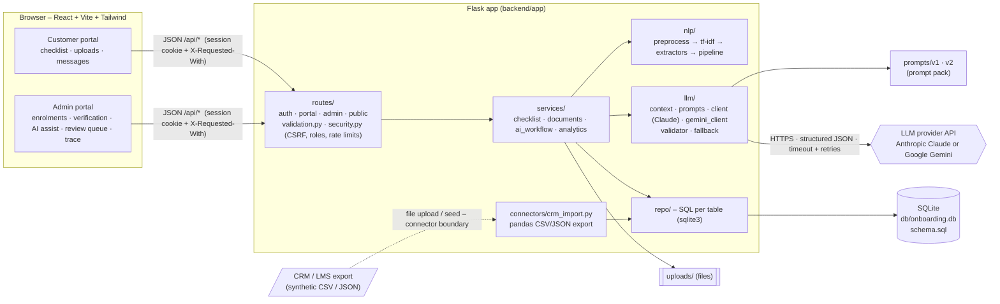
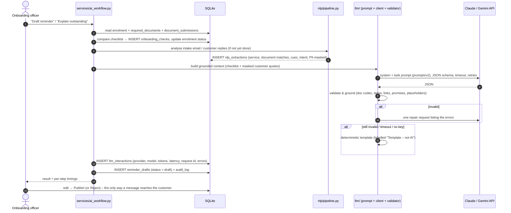
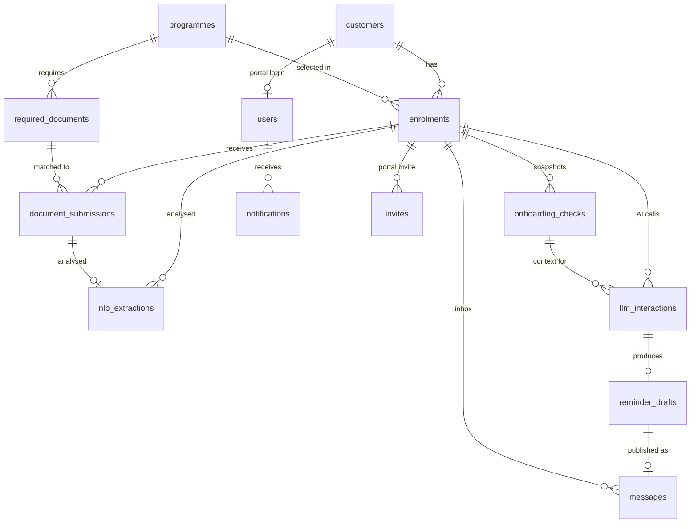

# Architecture and workflow

## Components

**The connector boundary:** the app never talks to a real LMS or CRM. Customers come in through
`connectors/crm_import.py` from a CSV/JSON export, using the synthetic files in
`backend/data/sample/`. Swapping in an approved CRM API would only change this module.

## AI workflow ("Read enrolment → compare checklist → NLP → LLM → save status")

## Data model (SQLite)

`audit_log` is append-only (database triggers block UPDATE and DELETE) and has no foreign keys,
so audit rows outlive the records they describe. Every table has `created_at`; statuses are
enforced with `CHECK` constraints. The full schema is in [`backend/db/schema.sql`](../backend/db/schema.sql).

## Module map

| Folder | Responsibility |
|---|---|
| `app/routes/` | HTTP endpoints only: input validation, role checks, JSON in/out |
| `app/services/checklist.py` | Pure checklist comparison (required vs. submitted, best submission per item, status rules) |
| `app/services/documents.py` | Uploads (type and size checks), NLP classification, intake-text processing |
| `app/services/ai_workflow.py` | The 7-step AI pipeline above, with timings for the trace view |
| `app/nlp/` | Cleaning, tokenising and stemming; PII masking; TF-IDF cosine similarity; phrase/fuzzy matching; date, score and amount entities; submission cues; intent rules; service detection |
| `app/llm/` | Grounded context, versioned prompts, Claude SDK client, Gemini HTTP client, validator, template fallback |
| `app/repo/` | Small SQL helpers per table (CRUD) |
| `app/connectors/` | CRM/LMS export import with pandas (validation report, duplicates, audit) |
| `app/errors.py` | Typed exceptions → consistent JSON errors (`validation_error`, `not_found`, `unsupported_request`, …) |
